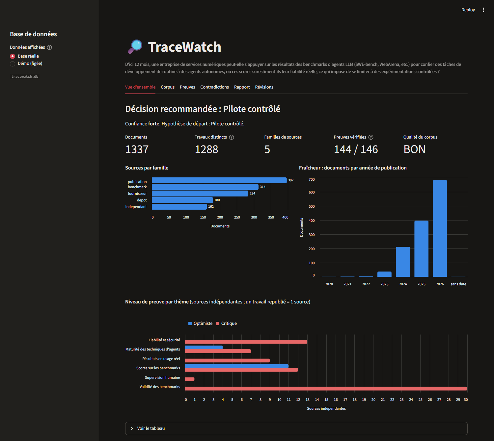
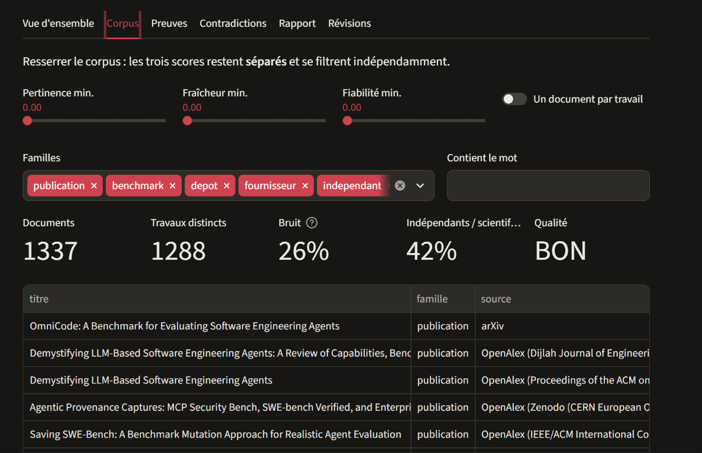
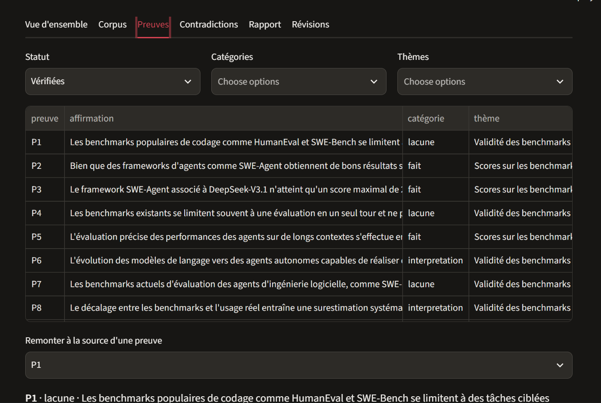
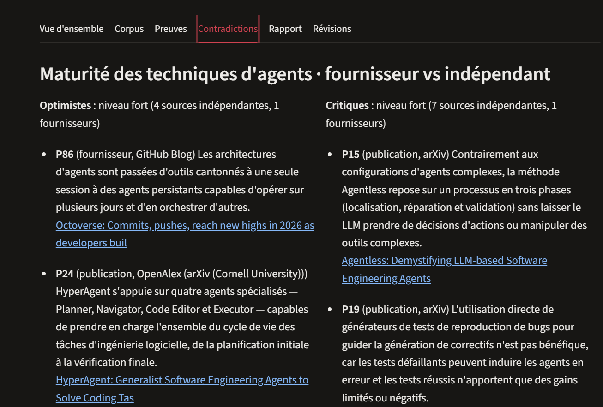
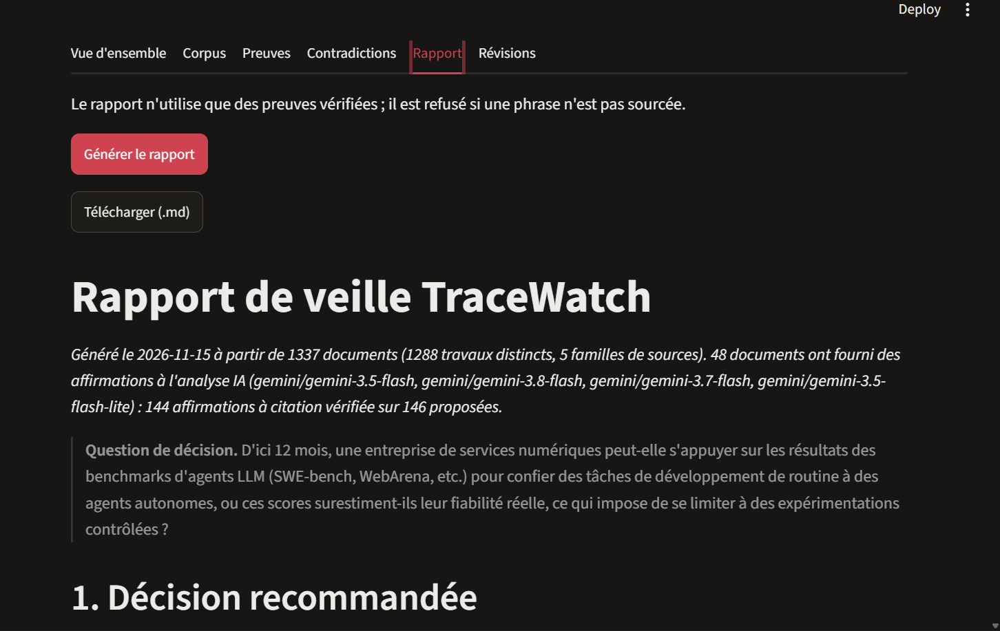
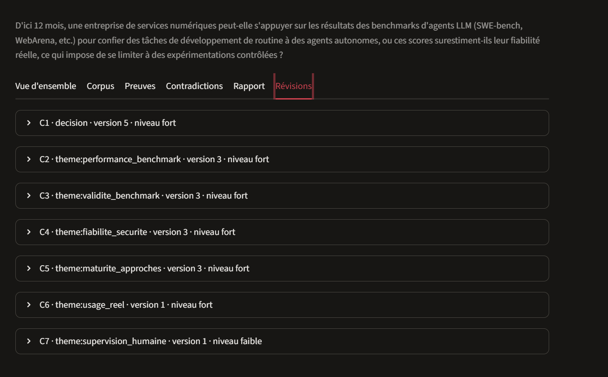
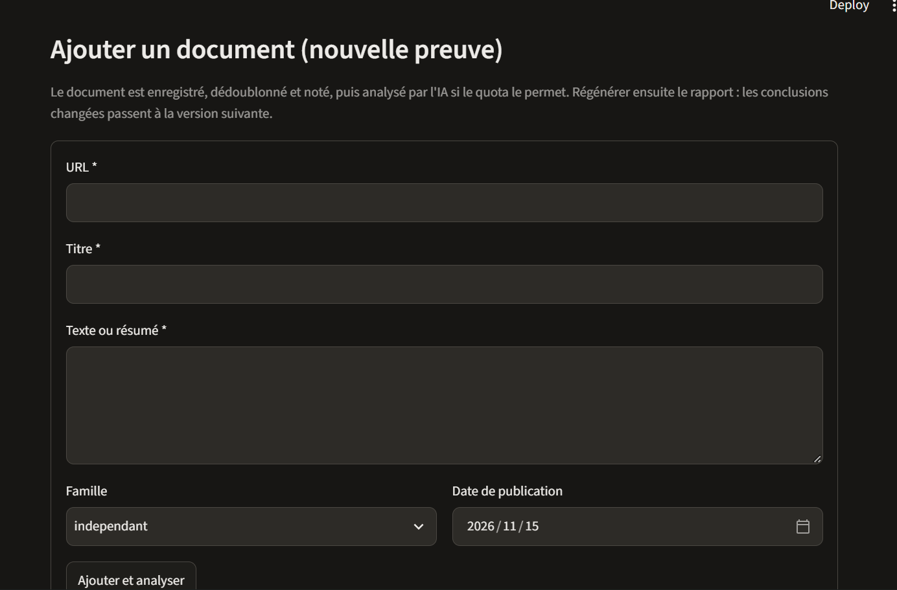

# TraceWatch

    

**English** | [Français](README.fr.md)

**A science and technology watch system: from a watch question to traceable evidence, then to a recommendation proportionate to the level of evidence.**

Final exam project, Option A (course *Science and Technology Watch*, 3rd-year Bachelor in Software Engineering & Networks). Team of 4 students.

> **Watch topic (topic 5):** within 12 months, can a digital services company rely on LLM agent benchmark results (SWE-bench, WebArena, etc.) to hand routine development tasks to autonomous agents, or do these scores overestimate their real-world reliability?

**Outcome:** based on 1,337 real documents (1,288 distinct works, 5 source families) and 144 pieces of evidence with verified quotations, the system recommends a **controlled pilot, with high confidence**.

> **Language note:** this README is available in English and French. The application interface, the generated reports and the project documents (`CADRAGE.md`, `ARCHITECTURE.md`, `docs/`, PDF guide) are in French. Code identifiers are also in French (for example `collecte` = collection, `fournisseur` = vendor, `independant` = independent).



*Dashboard, "Vue d'ensemble" (Overview) tab, real database: recommended decision, corpus indicators, sources by family, freshness and level of evidence by theme. The other tabs are shown in [section 8.5](#85-dashboard-preview).*

---

## 1. Project status

| Step | Content | Status | Deliverable |
|---|---|---|---|
| 0 | Framing the watch question | **Done** | `CADRAGE.md` |
| 1 | Architecture and stack | **Done** | `ARCHITECTURE.md` |
| 2 | Watch profile + project skeleton | **Done** | `config/profil_veille.yaml`, [GitHub repository](https://github.com/mifolotech/tracewatch) |
| 3 | Multi-source collection | **Done** | `src/tracewatch/collecte/` |
| 4 | Normalisation and deduplication | **Done** (test 1) | `src/tracewatch/normalisation/` |
| 5 | Qualification (scores, filters) | **Done** (tests 2, 4) | `src/tracewatch/scoring/` |
| 6 | Controlled AI analysis | **Done** (test 3) | `src/tracewatch/analyse/` |
| 7 | Traceability | **Done** (test 5) | `src/tracewatch/rapport/tracabilite.py` |
| 8 | Report + dashboard | **Done** | `src/tracewatch/rapport/`, `app/`, `rapports/` |
| 9 | Tests, security, reproducibility | **Done**; test by an outside person still to do | `tests/`, `data/demo/`, section 8 |
| 10 | Documentation and defence | **Done**; oral rehearsal still to do | `docs/` |

Decisions already made: project name **TraceWatch**, stack **Python + Streamlit + SQLite**, swappable LLM with a cache, starting hypothesis **"controlled pilot"** (the system must be able to refute it).

---

## 2. What we are building

An application that goes from a **watch question** to a set of **traceable pieces of evidence**, then to a **summary that supports a decision**.

**The 4 decision options:** generalise, controlled pilot, defer, exclude.

**Key principle:** AI helps (extraction, classification) but never decides alone. Every claim must quote a real passage from the source document, checked automatically. Otherwise it is rejected.

**The 5 tests the system must pass (exam):**
1. The same information republished on several sites does not count as several independent confirmations.
2. An old but highly relevant publication: relevance and freshness remain two separate dimensions.
3. A vendor claim contested by an independent source: the divergence appears in the analysis and the report.
4. A query that is too broad, with a lot of noise: the user can narrow the corpus or see its low quality.
5. A critical element of the report is challenged: the original document supporting it can be found quickly.

---

## 3. Project structure

```
tracewatch/
├── Guide_TraceWatch_Francais_Facile.pdf  # the whole project explained in plain French
├── README.md                  # this file (English, GitHub home page)
├── README.fr.md               # French version of this file
├── CADRAGE.md                 # step 0 (done): framing
├── ARCHITECTURE.md            # step 1 (done)
├── requirements.txt
├── pyproject.toml             # makes "import tracewatch" work everywhere
├── .env.example               # key template, no secret
├── .gitignore                 # ignores .env, database, cache
├── .gitattributes             # identical line endings for the whole team
│
├── config/
│   └── profil_veille.yaml     # step 2: question, keywords, sources, weights
│
├── data/
│   ├── demo/                  # frozen demo dataset + its LLM cache (versioned)
│   └── cache_llm/             # working LLM cache (ignored by Git)
│
├── src/tracewatch/
│   ├── db.py                  # SQLite schema
│   ├── demo.py                # step 9: frozen demo dataset (python -m tracewatch.demo)
│   ├── collecte/              # step 3, collection: python -m tracewatch.collecte
│   │   ├── __main__.py        # runs every source + summary by family
│   │   ├── commun.py          # profile, polite HTTP, dates, storage
│   │   ├── arxiv.py
│   │   ├── openalex.py
│   │   ├── github.py
│   │   ├── rss.py
│   │   └── benchmarks.py
│   ├── normalisation/         # step 4: python -m tracewatch.normalisation
│   │   ├── __main__.py        # runs the step + duplicate summary
│   │   ├── schema.py          # single document format
│   │   ├── dedup.py           # duplicates (URL, DOI, similarity)
│   │   └── clusters.py        # original work vs republications
│   ├── scoring/               # step 5: python -m tracewatch.scoring
│   │   ├── __main__.py        # computes scores + quality, full vs narrowed corpus
│   │   ├── pertinence.py      # relevance
│   │   ├── fraicheur.py       # freshness
│   │   ├── fiabilite.py       # reliability
│   │   └── qualite_corpus.py  # corpus quality
│   ├── analyse/               # step 6, analysis: python -m tracewatch.analyse
│   │   ├── __main__.py        # document selection, analysis, summary
│   │   ├── llm_client.py      # swappable LLM + cache
│   │   ├── extraction.py      # claims + quotations
│   │   ├── verification.py    # does the quotation really exist?
│   │   ├── contradictions.py  # vendor vs independent
│   │   └── niveau_preuve.py   # level of evidence
│   ├── rapport/               # steps 7 and 8, report
│   │   ├── tracabilite.py     # sentence -> evidence [Pn] -> document -> original
│   │   ├── __main__.py        # python -m tracewatch.rapport
│   │   ├── generateur.py      # decision rule + writing + check
│   │   └── revision.py        # new evidence, history
│   └── app/
│       └── streamlit_app.py   # dashboard (6 tabs)
│
├── tests/                     # step 9: one file per scenario (pytest)
│   ├── test_s1_doublons.py    # duplicates
│   ├── test_s2_fraicheur_pertinence.py  # freshness vs relevance
│   ├── test_s3_contradiction.py
│   ├── test_s4_bruit.py       # noise
│   ├── test_s5_tracabilite.py # traceability
│   ├── test_rapport.py        # full report, decision, revisions
│   ├── test_demo.py           # demo without key or network, reproducible
│   ├── test_securite.py       # no secret in the repository
│   └── test_app.py            # dashboard, including an empty database
│
├── rapports/                  # reports generated by the system
│   ├── dernier_rapport.md     # report on the real database
│   └── demo/                  # report on the demo dataset
└── docs/                      # step 10
    ├── architecture.md        # diagram, modules, technical decisions
    ├── schema_architecture.svg
    ├── note_methode.md        # 2-to-4-page method note
    ├── oral.md                # defence preparation
    └── captures/              # dashboard screenshots (README)
```

---

## 4. Tech stack

| Need | Choice |
|---|---|
| Language | Python 3.11+ |
| Interface | Streamlit |
| Database | SQLite |
| Collection | `requests`, `feedparser` (arXiv, OpenAlex, GitHub, RSS) |
| Deduplication | `scikit-learn` (TF-IDF, cosine similarity) |
| Configuration | `PyYAML`, `python-dotenv` |
| Tests | `pytest` |
| LLM | Gemini (only provider wired in; swappable client, see `analyse/llm_client.py`), key in `.env` |

**Absolute rule:** no API key in the code or in the deliverables. Keys go in `.env`, which is never pushed to GitHub.

---

## 5. Steps up to deployment

### Step 0. Framing (done)
- [x] Decision question, scope, horizon, 4 options
- [x] Have `CADRAGE.md` validated by the team
- [x] Send the question to the teacher for validation

### Step 1. Architecture and stack (done)
- [x] Stack, data flow, data contract, anti-hallucination AI module
- [x] Have `ARCHITECTURE.md` validated by the team
- [x] Choose the LLM provider: **Gemini**
- [x] Create **a single** Gemini key, kept by a single member

### Step 2. Watch profile + project skeleton
- [x] Create the structure above
- [x] Create the GitHub repository and push the project (see section 7) → [github.com/mifolotech/tracewatch](https://github.com/mifolotech/tracewatch)
- [x] Write `requirements.txt`, `.gitignore`, `.env.example`, `pyproject.toml`
- [x] Write `config/profil_veille.yaml`: question, keywords, horizon, source families, scoring weights
- [x] Create the SQLite schema (`db.py`) according to the data contract
- **Done when:** `pip install -r requirements.txt` works and the database is created (`python -m tracewatch.db`). ✅ Verified.

### Step 3. Multi-source collection (at least 4 families)
- [x] arXiv and OpenAlex (publications)
- [x] Benchmarks (SWE-bench Verified + Lite, WebArena: leaderboards, marked as verified / self-reported)
- [x] GitHub (agent projects, issues describing failures)
- [x] RSS feeds (3 vendors, 7 independent sources, filtered by keywords)
- [x] Every document keeps its URL, date, source type, author/organisation and collection date
- Run: `python -m tracewatch.collecte` (or `--sources arxiv rss` for some sources only). Running it again adds no duplicate URL.
- ✅ Verified on 2026-11-15: 1,337 real documents, 5 families (publication 397, benchmark 314, vendor 284, repository 180, independent 162).
- **Done when:** the database contains real documents from at least 4 families.

### Step 4. Normalisation and deduplication (test 1)
- [x] Single document schema (canonical URL, DOI, arXiv ID, content fingerprint)
- [x] Duplicate detection: canonical URL, DOI/arXiv ID, fingerprint, text similarity (TF-IDF ≥ 0.85), title contained in the other
- [x] "Original work" vs "republications" clusters (5 articles on the same study = 1 piece of evidence)
- Run: `python -m tracewatch.normalisation` (can be re-run, rebuilds the clusters)
- **Done when:** test 1 passes. ✅ `pytest tests/test_s1_doublons.py`: 9/9. On the real database: 1,337 documents → 1,288 distinct works (48 duplicate groups, all checked by hand).

### Step 5. Qualification (tests 2 and 4)
- [x] Three separate scores: relevance (distinct keywords, saturation), freshness (12-month half-life), reliability (family + verified/self-reported)
- [x] Narrowing filters and a corpus quality indicator (noise, families, independence, republications)
- Run: `python -m tracewatch.scoring`
- **Done when:** tests 2 and 4 pass. ✅ 7/7 and 4/4. Real database: 26% noise → 0% after narrowing (944 works, 5 families).

### Step 6. Controlled AI analysis (the core, 20% of the grade)
- [x] Swappable LLM client with a cache (Gemini `gemini-3.5-flash`; without a key: cache only)
- [x] Extraction of claims with an exact quotation
- [x] Automatic check that the quotation exists in the document (otherwise rejected), re-checked on every run
- [x] Classification: fact / interpretation / gap / risk / signal (+ theme, optimistic/critical position, sub-question)
- [x] Detection of vendor vs independent contradictions (by theme, opposite positions)
- [x] Level of evidence based on the number of **independent** sources (clusters, vendors counted separately)
- Run: `python -m tracewatch.analyse` (can be re-run: resumes where the quota stopped it)
- **Done when:** test 3 passes and no claim without a verified quotation enters the report. ✅ 15/15.
- Gemini free quota: **20 calls per day and per model** → automatic switch to fallback models (`modeles_secours` in the profile). Full real analysis: 63 documents, 146 claims, 144 verified quotations (2 genuine rejections).

### Step 7. Traceability (test 5)
- [x] Every sentence of the report points to an evidence identifier, then to the original document
- [x] Conclusions linked to their evidence (unverified evidence refused, level of evidence computed, version 1 recorded)
- [x] Automatic report check: every sentence has a verified [Pn] reference that is present in the appendix
- Find a source: click [Pn] in the report, or `python -m tracewatch.rapport.tracabilite P12` (or `C3`)
- **Done when:** test 5 passes and the source of a conclusion can be found in one click. ✅ 7/7.

### Step 8. Report + dashboard
- [x] Generated report: question, recommended decision proportionate to the level of evidence, facts, contradictions, uncertainties, risks, points to monitor
- [x] Streamlit dashboard: sources by family, freshness, level of evidence, contradictions (+ filterable corpus, evidence, report, revisions)
- [x] Revision: add new evidence, recompute the conclusion, keep the history
- Run: `python -m tracewatch.rapport` → `rapports/dernier_rapport.md`; `streamlit run src/tracewatch/app/streamlit_app.py`
- Decision rule and confidence capping: see the header of `rapport/generateur.py`
- **Traced revision of the decision rule:** after the full analysis, the first version of the rule recommended "exclude" (conclusion `decision`, version 3), because it tested exclusion without looking at promising results, contrary to `CADRAGE.md`. The rule was aligned with the framing document (versions 4 and 5: controlled pilot). The change is kept in the history of the real database (Révisions tab), explained in [`docs/note_methode.md`](docs/note_methode.md) and locked in by tests.
- **Done when:** a full report is generated from the demo dataset. ✅ Generated from the real database and from the demo (controlled pilot, high confidence), traceability check passed, `tests/test_rapport.py` 4/4. The frozen demo dataset is described in step 9.

### Step 9. Tests, security, reproducibility
- [x] One automated test per scenario (the 5 above), plus report, demo and security
- [x] Frozen demo dataset in `data/demo/`: 171 real documents + 63 cached LLM responses, rebuilt without a key or network
- [x] Check that no secret is in the repository: `tests/test_securite.py` (key patterns + real values from `.env`)
- [x] Installation README tested on a clean copy (clone, new environment, installation, demo, tests)
- [ ] Someone outside the team follows section 8 on their own computer
- **Done when:** `pytest` is green and an outside person launches the application by following the README. ✅ `pytest`: 64/64.

### Step 10. Documentation and defence
- [x] 2-to-4-page note: watch method, limits, risks → [`docs/note_methode.md`](docs/note_methode.md)
- [x] Architecture diagram → [`docs/architecture.md`](docs/architecture.md), [`docs/schema_architecture.svg`](docs/schema_architecture.svg)
- [x] Declaration of the libraries and AI services used, sources cited → section 10 below
- [x] Defence guide: common pitch, questions per module, demo script → [`docs/oral.md`](docs/oral.md)
- [ ] Oral rehearsal: each member explains their module and answers individually

---

## 6. Split across 4 members

| Step | Owner | Support |
|---|---|---|
| 0, 1, 2 | A (lead) | Whole team |
| 3 Collection | B | D |
| 4 Deduplication, 5 Scoring | C | B, A |
| 6 AI analysis | A | C |
| 7 Traceability, 8 Report and dashboard | D | A |
| 9 Tests and security | C (tests), B (README, `.env`) | Everyone |
| 10 Documentation | D (note), A (architecture) | Everyone rehearses the oral |

Rules: one Git branch per person, A merges, nobody changes someone else's module without telling them. Everyone must be able to explain the overall diagram in 2 minutes.

---

## 7. Deploying to GitHub

**Once (A):**

```bash
git init
git add .
git commit -m "Initial commit: TraceWatch"
git branch -M main
git remote add origin https://github.com/mifolotech/tracewatch.git
git push -u origin main
```

Before creating the repository on GitHub: **create it empty**, without a README or `.gitignore` added by GitHub, since they already exist here. Add the 3 other members as collaborators (Settings, Collaborators).

**Minimal `.gitignore`:**

```
.env
*.db
*.sqlite
# the demo cache lives in data/demo/ and stays versioned
data/cache_llm/*
__pycache__/
.venv/
```

**Daily work (each member):**

```bash
git checkout -b firstname-module     # once
git add . && git commit -m "clear message"
git push -u origin firstname-module
```

Then open a Pull Request on GitHub, which A merges into `main`.

**Check before submission:**

```bash
pytest tests/test_securite.py              # automatic: key patterns + real values from .env
git grep -n -i "api_key\|secret\|token"    # visual check: no real key must appear
git ls-files | grep -i "\.env"             # must only show .env.example
```

If a key was pushed to GitHub by mistake, **revoke it and create a new one**: removing it from a commit is not enough.

**Final submission:** version tag and clean repository.

```bash
git tag v1.0
git push origin v1.0
```

---

## 8. Installation and launch

**Requirements:** Python 3.11 or newer ([python.org](https://www.python.org/downloads/)), Git. No key is needed for the demo.

> **Windows:** clone into a folder with a short path (e.g. `C:\dev\tracewatch`). In a deeply nested folder, `pip install` may fail with "No such file or directory", because Windows limits paths to 260 characters (Streamlit contains files with long names). Alternative: [enable long paths](https://pip.pypa.io/warnings/enable-long-paths).

### 8.1 Install (once)

Windows (PowerShell):

```powershell
git clone https://github.com/mifolotech/tracewatch.git
cd tracewatch
python -m venv .venv
.\.venv\Scripts\Activate.ps1        # if refused: Set-ExecutionPolicy -Scope CurrentUser RemoteSigned
pip install -r requirements.txt
```

macOS / Linux:

```bash
git clone https://github.com/mifolotech/tracewatch.git
cd tracewatch
python3 -m venv .venv
source .venv/bin/activate
pip install -r requirements.txt
```

### 8.2 Run the demo (no key, no Internet)

```bash
python -m tracewatch.demo          # rebuilds the demo database and writes rapports/demo/dernier_rapport.md
streamlit run src/tracewatch/app/streamlit_app.py
```

The browser opens on the dashboard: choose **"Démo (figée)"** (frozen demo) in the sidebar. Stop with `Ctrl+C`.

On the very first launch, Streamlit asks for an email address ("Email:"): it is optional, just press **Enter**.

### 8.3 Check that everything works

```bash
pytest                             # 64 tests: the 5 scenarios, report, demo, security, dashboard
```

### 8.4 Full pipeline on fresh data (optional, Gemini key required)

```bash
cp .env.example .env               # Windows: copy .env.example .env, then paste the GEMINI_API_KEY into it
python -m tracewatch.collecte      # step 3: collection (Internet required, ~5 min)
python -m tracewatch.normalisation # step 4: duplicates and clusters
python -m tracewatch.scoring       # step 5: three scores and corpus quality
python -m tracewatch.analyse       # step 6: AI analysis (free quota: 20 calls/day, can be re-run)
python -m tracewatch.rapport       # steps 7-8: traceable report -> rapports/dernier_rapport.md
python -m tracewatch.demo --exporter   # optional: re-freeze the demo with this new data
```

Find the source of a piece of evidence or a conclusion: `python -m tracewatch.rapport.tracabilite P12` (or `C1`).

### 8.5 Dashboard preview

The dashboard has six tabs (interface in French). The sidebar switches between the **real database** ("Base réelle") and the **frozen demo dataset** ("Démo (figée)"). Screenshots taken on the real database, dark theme.

**Corpus**: narrow the corpus with three independent filters (relevance, freshness, reliability), source families, a keyword and the "One document per work" option. The indicators for noise, share of independent sources and quality update with every filter (test 4).



**Preuves** (Evidence): the claims extracted by the AI, filterable by status (verified or rejected), category and theme. The "Trace a piece of evidence back to its source" selector shows the exact quotation and the original document (test 5).



**Contradictions**: for each theme, optimistic and critical claims side by side, with their family, source and a link to the document. "Vendor vs independent" divergences are flagged (test 3).



**Rapport** (Report): generation of the watch report, checked before display (every sentence must cite a verified piece of evidence), and download in Markdown format.



**Révisions** (Revisions): every conclusion (C1 to C7) with its version history, the reason for each change and the evidence added or removed.



**Add a piece of evidence** (at the bottom of the Revisions tab): a new document is stored, deduplicated, scored and then analysed. Regenerating the report moves the conclusions that changed to their next version.



---

## 9. Deliverables (exam checklist)

- [x] Executable application or prototype → Streamlit dashboard + `python -m tracewatch.*` commands
- [x] Clean, documented source code without secrets → `src/`, 64 tests including `tests/test_securite.py`
- [x] Installation and launch README → section 8 (tested on a clean copy)
- [x] Short description of the architecture and technical decisions → `docs/architecture.md`
- [x] Demo dataset or profile → `data/demo/` + `config/profil_veille.yaml`
- [x] Watch report produced by the system → `rapports/dernier_rapport.md` (and `rapports/demo/`)
- [x] 2-to-4-page note (method, limits, risks) → `docs/note_methode.md`
- [ ] Oral presentation and demonstration, with individual defence → prepared in `docs/oral.md`, to be rehearsed

**Indicative grading:** question and method 15%, collection and traceability 15%, normalisation and deduplication 15%, evidence analysis 20%, report 15%, technical quality and security 10%, interface and defence 10%.

**What the assignment values:** a simple but methodologically sound solution, able to explain where its conclusions come from, is worth more than a spectacular application.

---

## 10. Declarations

### Libraries (tested versions)

| Library | Version | Use |
|---|---|---|
| streamlit | 1.67 | Dashboard (with altair 6.3 and pandas 3.1 for charts and tables) |
| requests | 2.34 | Calls to the collection APIs |
| feedparser | 6.0 | RSS/Atom feeds and arXiv API |
| scikit-learn | 1.9 | TF-IDF and cosine similarity (deduplication) |
| PyYAML | 6.0 | Watch profile |
| python-dotenv | 1.2 | Reading keys from `.env` |
| google-genai | 3.3 | Gemini client |
| pytest | 9.2 | Automated tests |

### AI services used

- **In the product:** Google Gemini, free tier, temperature 0; main model `gemini-3.5-flash`, fallback models `gemini-3.8-flash`, `gemini-3.7-flash`, `gemini-3.5-flash-lite`, for extracting claims and quotations (step 6). Each claim keeps in the database the model that produced it (`claims.modele`), and every response is kept in the cache (`data/cache_llm/`, `data/demo/cache_llm/`).
- **During development:** Claude (Anthropic), via Claude Code, as a programming assistant for writing code, tests and documentation, under the team's direction. *(To be adapted by the team according to the exam's declaration rules.)*

### Data sources

| Source | Access | Family |
|---|---|---|
| arXiv | Public API `export.arxiv.org` | publication |
| OpenAlex | Public API `api.openalex.org` | publication |
| GitHub | Public API (SWE-bench, WebArena, SWE-agent, OpenHands repositories and their issues) | repository (`depot`) |
| SWE-bench | Official leaderboard `swebench.com` (Verified, Lite) | benchmark |
| WebArena | Public leaderboard (Google Sheet referenced by the official repository) | benchmark |
| OpenAI, GitHub Blog, Google DeepMind | Public RSS feeds | vendor (`fournisseur`) |
| METR, AI as Normal Technology, Simon Willison, Gary Marcus, Interconnects, Ars Technica, The Register | Public RSS feeds | independent (`independant`) |

Every document cited in a report is referenced with its URL in the "Preuves" (Evidence) appendix. The full list of feeds is in `config/profil_veille.yaml`.
