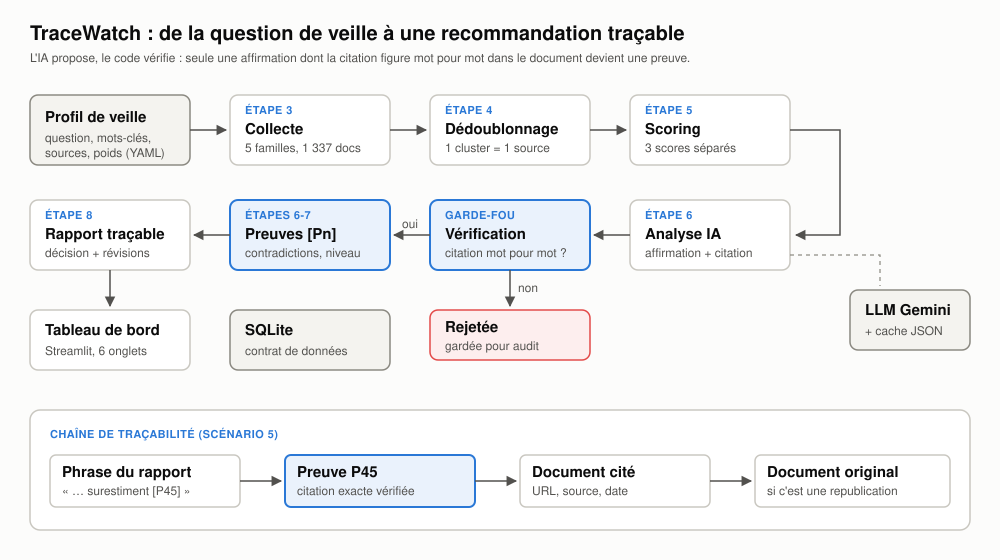
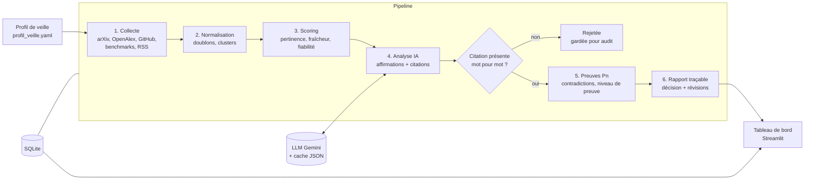

# TraceWatch : architecture et décisions techniques

## Schéma

## Modules

| Étape | Module | Commande | Rôle |
|---|---|---|---|
| 2 | `db.py` | `python -m tracewatch.db` | Schéma SQLite (contrat de données), migrations automatiques |
| 3 | `collecte/` | `python -m tracewatch.collecte` | 5 familles de sources, pauses et nouveaux essais, aucun doublon d'URL |
| 4 | `normalisation/` | `python -m tracewatch.normalisation` | URL canonique, DOI, arXiv ID, empreinte, similarité, clusters |
| 5 | `scoring/` | `python -m tracewatch.scoring` | 3 scores séparés, filtres, indicateur de qualité |
| 6 | `analyse/` | `python -m tracewatch.analyse` | LLM et cache, extraction, vérification, contradictions, niveau de preuve |
| 7 | `rapport/tracabilite.py` | `python -m tracewatch.rapport.tracabilite P12` | Phrase → preuve → document → original ; contrôle du rapport |
| 8 | `rapport/` | `python -m tracewatch.rapport` | Règle de décision, rédaction, révisions versionnées |
| 8 | `app/streamlit_app.py` | `streamlit run src/tracewatch/app/streamlit_app.py` | Tableau de bord en 6 onglets |
| 9 | `demo.py` | `python -m tracewatch.demo` | Démo figée reconstruite sans clé ni réseau |

## Données

Sept tables SQLite : `documents`, `clusters`, `scores`, `claims` (affirmations), `conclusions`, `conclusion_claims`, `revisions`. Le contrat détaillé est dans [ARCHITECTURE.md](../ARCHITECTURE.md). La règle centrale tient en une phrase : **une affirmation ne sert de preuve que si `citation_verifiee = 1`**.

## Décisions techniques et leurs raisons

| Décision | Pourquoi | Alternative écartée |
|---|---|---|
| **SQLite** | Un seul fichier, aucune installation, reproductible | PostgreSQL : surdimensionné pour 1 300 documents |
| **TF-IDF + similarité cosinus** pour les doublons | Explicable à l'oral, rapide, sans modèle lourd | Embeddings neuronaux : boîte noire, et gain non démontré sur ce corpus |
| **Un cluster = une source indépendante** | Cinq republications d'une étude ne sont pas cinq confirmations | Compter les documents : gonfle artificiellement le niveau de preuve |
| **Trois scores jamais fusionnés** | Un document ancien peut rester central (scénario 2) | Score unique pondéré : masque la raison du classement |
| **Vérification des citations par le code** | Seul garde-fou objectif contre l'hallucination | Faire confiance au LLM, ou lui demander de s'auto-vérifier |
| **Rapport rédigé par le code, pas par le LLM** | Chaque phrase est garantie sourcée ; un texte libre du LLM réintroduirait des affirmations non vérifiées | Synthèse rédigée par le LLM : plus fluide, mais invérifiable |
| **Règle de décision explicite** | Discutable, reproductible, proportionnée au niveau de preuve | Laisser le LLM recommander : opaque |
| **Cache des réponses LLM** | Démo reproductible sans clé, économie de quota | Rappeler le LLM à chaque fois : coûteux et non déterministe |
| **Fournisseur LLM interchangeable** | Un modèle a été retiré pendant le projet (`gemini-2.5`) | Code lié à un seul modèle |
| **Thèmes imposés au LLM** | Permettent de rapprocher des affirmations de sources différentes pour détecter les contradictions | Thèmes libres : impossibles à comparer |
| **Conclusions versionnées** | On voit comment la recommandation évolue avec les preuves | Écraser la conclusion : perte de l'historique |

## Sécurité

- **Clés :** les clés vivent dans `.env`, ignoré par Git. `.env.example` est sans valeur. `tests/test_securite.py` cherche les formats de clés connus et la valeur réelle de chaque clé du `.env` dans tous les fichiers du dépôt.
- **Rôle du LLM :** il ne déclenche aucune action. Ses sorties sont des propositions vérifiées contre le document source, ce qui limite l'effet d'une injection de consignes cachée dans un document collecté.
- **Collecte :** elle se fait par les API publiques officielles (arXiv, OpenAlex, GitHub) et par les flux RSS, avec des pauses entre les appels (3 s pour arXiv, selon sa règle).
